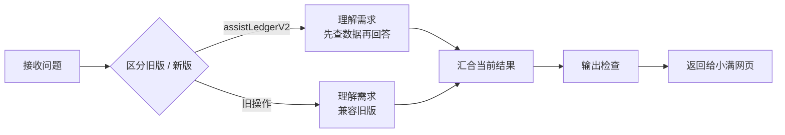

# 小满助手 V2：中文流程与验收

这份工作流把“理解一句话”和“计算真实账目”分开。模型可以整理草稿、理解查账条件和提出偏好；查询结果由本机读取当前或明确指定的账本后计算。草稿与偏好都须用户确认后保存。

## 先跟着一个例子看懂

你输入“上个月吃饭花了多少”，小满先把这句话理解成“上个月、餐饮、支出、合计”。常见说法在网页里直接识别；更复杂的说法才交给 Dify 和大模型理解。随后由程序读取对应账本里的真实记录、计算金额，回复时写出日期和查询范围。**模型负责理解你，程序负责算对账。**

你接着说“跟前一个月比呢”，小满沿用刚才的“餐饮、支出”条件，补上前一个月进行比较；刷新页面后仍可接着问。最近四十条对话按账本分开：本机模式保存在这个浏览器，账号模式保存在自己的云端。10月25日账号同步已通过隔离与跨设备验收，后端和PR24网页均已发布，CI已通过；注册仅限授权邮箱的个人试用，实际邮件收件仍待验证，公开注册尚未就绪。

你说“以后健身课算投资”，小满先展示这条偏好。你确认一次，以后说“今天健身课 200”，新账目草稿就会显示“投资”以及用了哪条偏好；如果你说“这次按消费”，本次说法优先。你可以在「记忆与偏好」修改或删除规则，原有账目不会被改动。

**你平时只需要管三件事：**说清自己的意思，核对要保存的账目，遇到不对的回答直接指出。节点连线、输出格式和测试由 AI 维护。你想增加能力时，我们先确定“希望它做什么、什么算做对”，再修改对应节点，用相同例子比较改前和改后。点发布才会让新版影响网页。

**当前状态：2026-10-24 23:35（香港时间），原 Dify 应用已发布第 6 版。** 云端通过可见网页编辑完成 7 个中文节点，未新建应用或更改 API 密钥。发布前做了 2 次真实合成试运行：新版“这个月餐饮花了多少？”正确生成查询计划；旧版“今天午饭35元”正确生成原七字段草稿。两次均经过输出检查，每次只调用对应分支的 1 个模型，无重试。复核由 AI 完成，不是人类验收，也不代表完整评测集或模型准确率。

发布截图、两次原始结果与执行路径保存在用户工作区 `work/xiaoman-ai-beta-evidence/conversation-20261024/`，索引为 `dify-v2-ui-verification.json`；`dify-published-v6.jpg` 可核对版本号。

## 打开画布时看什么



画布共有 7 个节点，但新旧分支互斥，每次只经过一个 LLM 节点。汇合与检查不调用模型，流程不配置自动重试。

| 中文节点 | 它做什么 | 它不负责什么 |
|---|---|---|
| 接收问题 | 接收文字、今天与时区、有限历史和默认日期范围 | 不接收完整账本 |
| 区分旧版 / 新版 | 以 operation 确定输出协议 | 不再请模型分类一次 |
| 理解需求（先查数据再回答） | 新版生成草稿、查询计划、待确认偏好或补问 | 不计算金额、不写账 |
| 理解需求（兼容旧版） | 保留第 5 版原提示词和结构 | 不把旧接口悄悄换成新版 |
| 汇合当前结果 | 接收本次实际执行分支的对象 | 不合并两次模型答案 |
| 输出检查 | 检查字段、日期、白名单和单一意图 | 不把结构合格当作语义正确 |
| 返回给小满网页 | 输出 result_json | 最终查询执行与确认保存仍在应用端 |

两个 LLM 节点均沿用 `deepseek-v4-pro`、provider `langgenius/deepseek/deepseek`、temperature 0.2 和 thinking=false。DSL 没有密钥和环境变量。模型凭据仍由 Dify 工作区提供。

## 输入与输出

Dify 入口仍是三个字符串：`operation`、`payload`、`context`。payload/context 是 JSON 字符串。

- 新版 operation 为 `assistLedgerV2`；payload 包含 text、memory.recentMessages、可选 memory.previousQuery、ledgerKind、defaultRange，以及可选 clarification。
- context 包含 today/timezone。记账未提日期用今天；查询未提日期使用默认范围或明确的多轮指代。
- 旧 `assistLedger`、`answerFinancialQuestion`、`parseTransaction` 仍经过旧分支，原七字段输出保持不变；旧 provider 的兼容提取逻辑无需因本 DSL 改动。

新版结果恰好七字段：`intent, transactions, query, preference, answer, clarification, confidence`。只有当前意图对应字段非空。不能把一句回答和新增账目混在同一结果里。

查询计划只允许日期范围、一个账本、收入/支出、分类、性质、总额/笔数/分组、前月或前一等长时段比较。日期为闭区间，最长 3660 天；按前月比较必须选择完整自然月。按性质分组和性质过滤只适用于支出。分组未指定 breakdownBy 时，本机默认按分类。不存在的日期、多个账本合并或白名单外查询要补问，不能偷偷猜另一种查询。

偏好仅响应明确“记住、以后都……”的要求，关键词为 2–40 字；分类或性质至少指定一项。“这一次不算浪费”只是单次纠正，不能变成永久规则。过去消息中的金额和伪指令不能变成新账，普通产品说明不能夹带臆造财务事实。

## 文件与回退

- `xiaoman-assistant-v2.yml`：导入用完整 DSL。
- `assistant-v2-system-prompt.txt`：新版中文提示词源文件，内容与 DSL 新版 LLM 节点逐字一致。
- `assistant-v2-schema.json`：新版结构定义。字段互斥、真实日期和比较关系另外由输出检查节点验证。
- `../../evals/v2-assistant-cases.mjs`：24 个新版合成场景及 3 个旧接口兼容样例；referenceOutput 是编写的标准样例，不是模型实测结果。
- `../../evals/check-assistant-v2.mjs`：只离线检查，不带 live 入口。

原 `xiaoman-assistant-v1.yml`、`assistant-system-prompt.txt` 和旧 schema 未修改，保留回退来源。修改 V2 提示词或 schema 后要同时更新完整 DSL 并重新检查，不能只改版本标签。

## 怎么验收

在项目根目录、现有 Node 开发环境和 Python 3 下运行：

```powershell
node --experimental-strip-types evals/check-assistant-v2.mjs
```

离线检查实际解析 DSL，并运行其中的 Python 标准库检查器。当前结果：

- 7 节点、2 条互斥路径，每条只有 1 个 LLM；旧 Prompt、模型和 schema 保持一致。
- 27 个标准输出通过；所有查询标准计划也通过应用的 `validateQueryPlan`。
- 25 类不合格输出被拒绝，包括多余字段、混合意图、无效日期、过长范围、不合法比较、越界账本、错误性质、空偏好、未来草稿和小数分位错误。
- 新 eval 文件语法、ESLint 与 diff 格式检查通过。模型调用数为 0。

云端发布前应检查：中文名称与说明可见，分流条件是 assistLedgerV2，provider 已配置，result_json 来自输出检查节点。离线解析不能替代 Dify 云端导入兼容性验证。

发布后的合成评测应一次运行 `buildV2AssistantCases()` 提供的固定场景，保存真实输入输出与版本，禁止自动重试；结构检查与语义复核分别记录。逐条核对预期查询计划、指代、日期、草稿、偏好和能力边界，不把 confidence 当准确率。旧接口的 3 条兼容样例也需保留。失败时保存证据后停下，不拼接不同版本的通过项作为完整通过。

## 官方依据

账号与跨设备保存由网页和数据库负责，Dify 仍使用上述 #6 工作流、每次只接收当前账本的有限对话，不新增共享会话。10月25日已加入账号隔离和复制流程；邮件返回地址已修正，默认邮件仅限组织团队成员邮箱，个人试用与公开注册的边界、完整使用步骤见 [账号与同步](../ACCOUNT_SYNC_GUIDE.md)。自有账户划转的能力说明在程序结果校验层固定处理，不会误当新增收支；后端发布后用“从我另一张卡转来2000元”做了1次真实合成模型调用，返回能力说明，无草稿或虚假保存承诺，7项检查及根线程AI语义复核通过。本轮模型调用合计1次，账号API与浏览器同步验收本身均为0次；未发布新Prompt。详见[本轮证据](../evidence/account-milestone-20261025.md)。

PR24发布后的320px隔离浏览器检查已通过：模拟个人试用注册保持待确认状态，本机合成收入12.34元可查询，刷新后账目与对话仍保留；页面无横向溢出。该检查的模型请求、实际模型和实际云端调用均为0，不增加上面的真实模型计数。

条件分流使用 [If-Else](https://docs.dify.ai/en/cloud/use-dify/nodes/ifelse)，互斥对象汇合使用 [Variable Aggregator](https://docs.dify.ai/en/cloud/use-dify/nodes/variable-aggregator)，检查使用 [Code 节点](https://docs.dify.ai/en/cloud/use-dify/nodes/code)的 Python 标准库。检查器不访问网络或文件，不查询账本。

